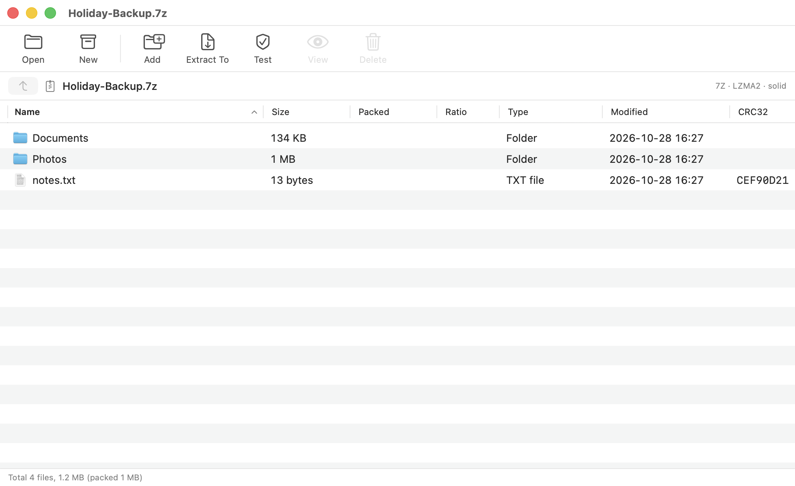

<p align="center">
  <picture>
    <source media="(prefers-color-scheme: dark)" srcset="docs/assets/archivex-lockup-dark.svg">
    
  </picture>
</p>

<p align="center">
  <b>A fast, native archive manager for macOS — with its own archive engine.</b><br>
  Open, create and extract ZIP, 7z, RAR (all versions from 3 up), TAR and more in a clean WinRAR-style window.
</p>

<p align="center">
  
  
  
  
  
</p>

<p align="center">
  
</p>

---

## Why ArchiveX

- **Everything is ours.** Every format is read and written by ArchiveX's own code (`Sources/Core`). No bundled
  7-Zip, no RARLAB binaries, no libarchive, no Homebrew — just Apple's system frameworks. Passwords never appear on a
  command line because there is no command line.
- **A familiar window.** A toolbar and file table in the spirit of WinRAR: Add, Extract To, Test, View, Delete.
- **Native and fast.** SwiftUI + AppKit, drag and drop, progress with Cancel, Finder integration, dark mode.
- **Universal.** One build runs natively on Apple Silicon and Intel Macs.
- **Safe extraction.** Entries that try to escape the destination folder (`../`, absolute paths, symlink tricks) are
  skipped and reported. Archives are checksummed while they are read, so damage is detected instead of ignored.

## Formats

| Format | Open · list · test · extract | Create | Add / delete files |
|---|:---:|:---:|:---:|
| **ZIP** — Deflate, Deflate64, bzip2, LZMA, store, ZIP64, AES-256, ZipCrypto, UTF-8 names, split sets (`.zip.001`) | ✅ | ✅ | ✅ |
| **7z** — LZMA2, LZMA, PPMd, BZip2, Deflate, store, BCJ / BCJ2 / ARM / ARM64 / Delta filters, split sets (`.7z.001`), AES-256, encrypted file names, solid | ✅ | ✅ | ✅ |
| **RAR 5** — all methods, solid, filters, AES-256, encrypted headers | ✅ | ❌ ¹ | ❌ |
| **RAR 3 / RAR 4** — LZ and PPMd text compression, all six filters, AES-128, encrypted file names, solid, multi-volume sets (`.part01.rar`, `.rar`/`.r00`) | ✅ | ❌ ¹ | ❌ |
| **TAR** (ustar, pax, GNU) | ✅ | ✅ | ✅ |
| **TAR.GZ · TAR.BZ2 · TAR.XZ** | ✅ | ✅ | — |
| **GZ · BZ2 · XZ** single files | ✅ | — | — |
| **ISO 9660** (Joliet, Rock Ridge) | ✅ | — | — |
| **CPIO** (newc, odc) | ✅ | — | — |

¹ RARLAB's license reserves the RAR compression algorithm, so ArchiveX can read RAR but will never create it.

**Not supported (yet):** RAR 1.x / 2.x (pre-2000 archives), multi-volume RAR 5, DMG, CAB, WIM, XAR, ARJ, LZH,
Info-ZIP style `.z01` spanned ZIPs, ZIP archives that use PPMd. ArchiveX tells you plainly when it meets one of these.

## Install

1. Download **ArchiveX.zip** from the [Releases](../../releases) page and unzip it.
2. Drag **ArchiveX.app** into `/Applications`.
3. **First launch.** ArchiveX is not notarized by Apple yet (that needs a paid Apple Developer ID), so macOS shows
   *“ArchiveX” Not Opened — Apple could not verify…*. This is expected and does not mean anything is wrong with the app.
   **Click “Done” (not “Move to Bin”), then:**
   - **macOS 15 Sequoia and later:** open **System Settings → Privacy & Security**, scroll to the *Security* section,
     click **Open Anyway** next to “ArchiveX was blocked”, and confirm with your password. You only do this once.
   - **macOS 13–14:** right-click the app → **Open** → **Open**.
   - **Any version, one command** (removes the download quarantine flag):

     ```bash
     xattr -dr com.apple.quarantine /Applications/ArchiveX.app
     ```

   You can check that the download is genuine before opening it, as shown below.

Verify your download (see [Releases](../../releases) for the checksum and provenance attestation):

```bash
shasum -a 256 -c SHA256SUMS
gh attestation verify ArchiveX.zip --repo YashDayani/ArchiveX
```

## Using it

| | |
|---|---|
| **Open** an archive | Drop it on the window, use *Open With → ArchiveX*, or press <kbd>⌘</kbd><kbd>O</kbd> |
| **Create** an archive | Drop files or folders on the window, or press <kbd>⌘</kbd><kbd>N</kbd> |
| **Extract** | <kbd>⌘</kbd><kbd>E</kbd> choose a folder · <kbd>⇧</kbd><kbd>⌘</kbd><kbd>E</kbd> here · <kbd>⌥</kbd><kbd>⌘</kbd><kbd>E</kbd> to a subfolder |
| **Test** integrity | <kbd>⌘</kbd><kbd>T</kbd> |
| **Add** to the open archive | <kbd>⇧</kbd><kbd>⌘</kbd><kbd>A</kbd> |
| **View** one file | Double-click it — it is extracted to a temporary folder and opened |

Select files or folders first to extract only those. Encrypted archives ask for the password when needed.

## Compatibility

- **macOS 13 Ventura or later**, including current releases. Only public SwiftUI / AppKit / system APIs are used.
- **Apple Silicon (M1 and later) and Intel** — a universal binary. The engine is plain Swift with no
  architecture-specific code, so both behave identically.

### How it was tested

The engine has its own test suite (`Tests/`) that checks ArchiveX against independent tools: it creates archives
and has **7-Zip, RARLAB `rar`/`unrar`, macOS `unzip`, `tar`, `gzip`, `bzip2` and `hdiutil`** read them, and has
ArchiveX read archives those tools produce — every compression method, level, filter, encryption mode and damage case.
Current status: **all checks pass on Apple Silicon (macOS 26) and for the Intel build running under Rosetta 2**.
The Intel build has not been run on physical Intel hardware. Those external tools are only test oracles on a
developer's machine; none of them is part of the app or needed to build or run it.

## Build from source

Requires Xcode (or its Command Line Tools) on macOS 13+. Developed with Xcode 27.

```bash
./build.sh                 # → build/ArchiveX.app   (universal: arm64 + x86_64)
open build/ArchiveX.app
```

Run the tests (needs the oracle tools above installed locally — see [`Tests/README.md`](Tests/README.md)).

## How it works

```
SwiftUI window  →  ArchiveModel  →  ArchiveX Core (Sources/Core)
 (Views, Sheets)   (state, actions)     ZIP · 7z · RAR 3/4/5 · TAR · GZ · BZ2 · XZ · ISO · CPIO
                                        LZMA/LZMA2 · PPMd · BZip2 · Inflate · AES · BCJ filters
```

- `Core/Zip.swift`, `SevenZip.swift`, `Rar5.swift`, `Rar4.swift`, `Tar.swift`, `Xz.swift`, `Gzip.swift`, `Bzip2.swift`, `Disc.swift` —
  container formats.
- `Core/Lzma.swift`, `Ppmd7.swift`, `Inflate.swift`, `Bzip2.swift`, `Filters.swift`, `Crypto.swift` — the codecs, written from the
  published format descriptions. Deflate *compression* uses Apple's Compression framework; AES, SHA and PBKDF2 use
  Apple's CommonCrypto / CryptoKit.
- `Core/AXCore.swift` — the façade the app calls: list, extract, test, create, edit — all in-process and cancellable.

## Known limits

- The app is ad-hoc signed and not notarized, so macOS asks you to approve it once (see [Install](#install)). Releases are
  signed and notarized automatically as soon as an Apple Developer ID is configured for the release workflow.
- Compression ratios are close to, but not always identical to, those of 7-Zip. BZ2 compression is slow on highly
  repetitive data.
- Editing a 7z archive rewrites it. TAR.GZ / TAR.BZ2 / TAR.XZ and RAR archives are read-only after creation.

## License

**Free for noncommercial use.** ArchiveX is source-available under the
[PolyForm Noncommercial License 1.0.0](LICENSE): you can use, study, modify and share it for personal, hobby,
research, educational and nonprofit purposes. **You may not sell it, bundle it into a paid product, or otherwise use
it commercially.** For commercial licensing, contact the author. (This is a source-available license, not an
OSI-approved "open source" license, because open-source licenses must allow commercial use.)

ArchiveX is an independent project and is not affiliated with RARLAB, WinRAR or 7-Zip. Archive formats are
implemented from their public specifications; the RAR compression algorithm is **never** re-created — ArchiveX only
decompresses RAR, as RARLAB's license permits.
